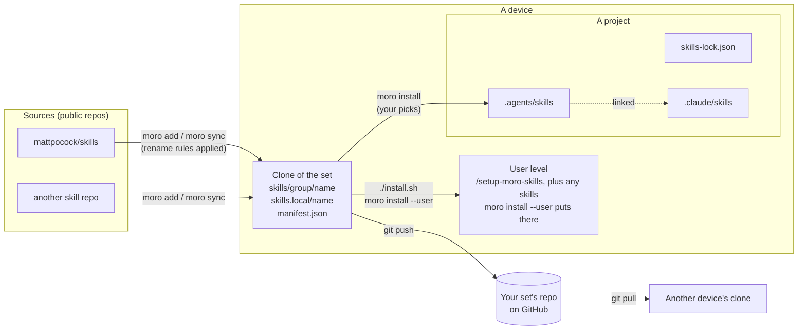
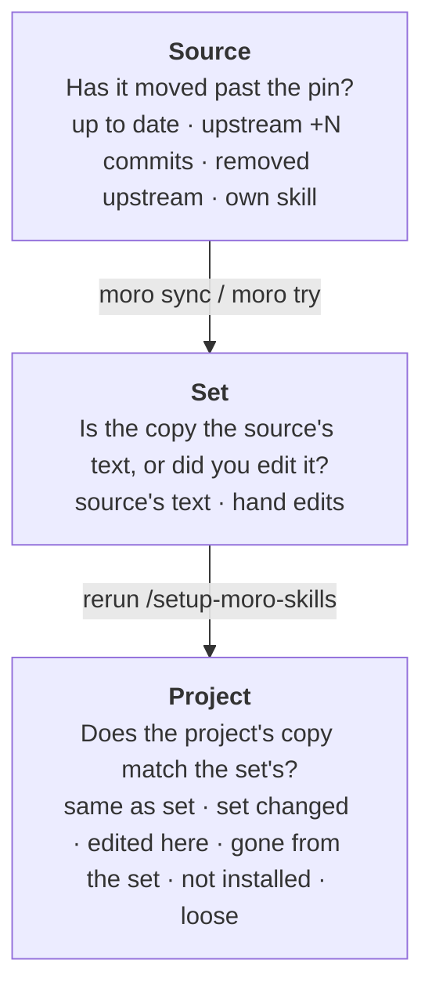
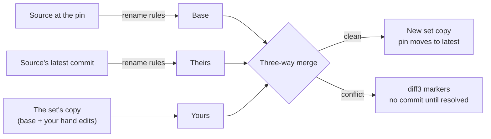
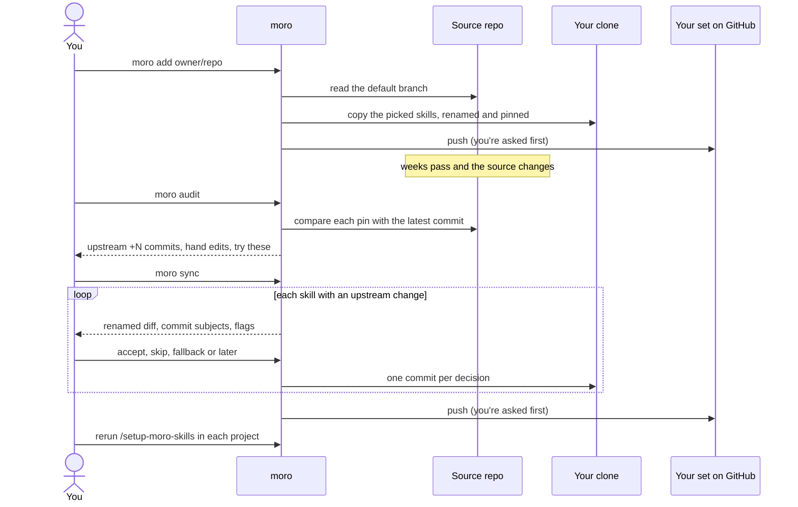
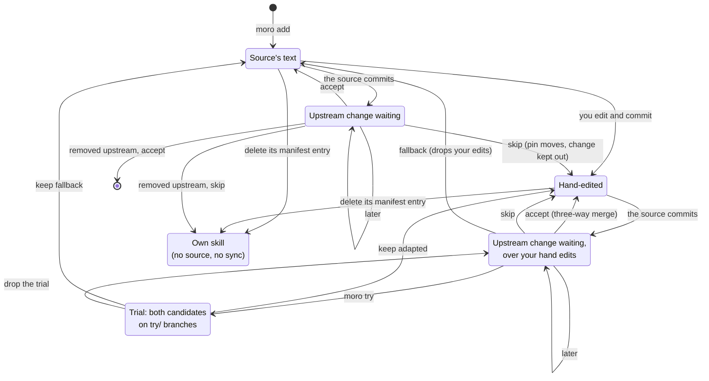
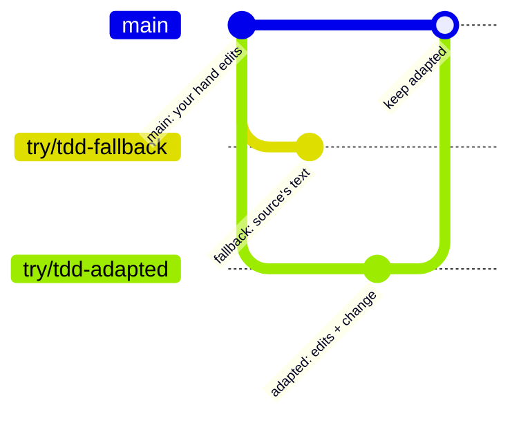
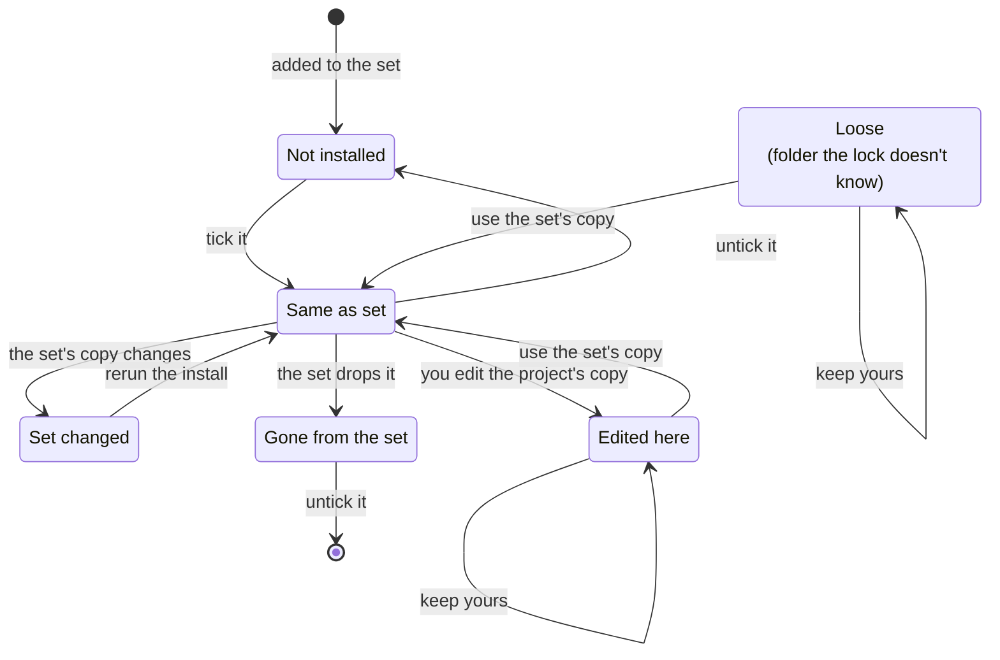

# Moro Skills

My set of agent skills, kept in one repo. Each device clones it and installs from that clone, one project at a time. Vocabulary is in [GLOSSARY.md](GLOSSARY.md), decisions in [docs/adr/](docs/adr/).

## What it's for

Skill sets like `mattpocock/skills` are great starting points, but installing them straight from their repos gets messy:

- every project gets every skill;
- an update overwrites your edits without showing you a diff;
- your own skills live in loose folders that no tool tracks.

Moro puts one repo of your own, the **skill set**, between those public repos and your projects. With it you can:

- **Subscribe** to as many public skill repos (**sources**) as you like, and take the skills you want from each.
- **Rename** what they ship into your own names, by rules rather than by hand.
- **Edit** any skill. Your **hand edits** survive every update from its source.
- **Track** each source, and decide on each **upstream change** one skill at a time: take it, skip it, take it without your edits, or try both versions first.
- **Install** into each project only the skills it needs, from the copy of the set on that device (the **clone**).
- **Keep** device-only skills, such as company ones, out of every commit.

The words in bold are defined in [GLOSSARY.md](GLOSSARY.md).

## How it works

### The mental model

Skills flow one way, from the sources through your set to your projects. Your decisions sit at each step.



- **Sources** are never forked or cloned by hand. The **manifest** names each source repo, and **pins** every skill taken from it to the commit it came from.
- **The clone** is the only place skills install from on a device. GitHub just carries commits between your devices, and moro never pulls for you.
- **A project** holds copies of the skills it picked, recorded in its **lock file**.
- **User level** always holds the **entry skill**, `/setup-moro-skills`. `moro install --user` can put more skills there, so every project on the device gets them, even one you never set up.

### Three layers, three questions

Every skill can be asked about at three layers. `moro audit` answers all three in one table.



### How a skill's text is made

The set's copy of an upstream skill is always the source's text at the pin, put through the source's **rename rules**, plus your hand edits. When the source changes, sync merges three versions, so your edits and the source's change both survive.



## Use cases

| You want to… | Do this |
| --- | --- |
| Set up a new device | Clone the set, run `./install.sh` |
| Give a project its skills | Run `/setup-moro-skills` in the project |
| Give every project on this device the skills | `moro install --user`, or pick "user level" in `/setup-moro-skills` |
| Catch a project up with the set | Rerun `/setup-moro-skills` there. `moro` in the project says when it's needed |
| Subscribe to a public skill repo | `moro add owner/repo` and pick its skills, or `--all` |
| Rename a source's names into yours | Add a pair to that source's `rename` list in `manifest.json`, then run `moro sync` to re-render its skills |
| See whether sources have moved on | `moro audit`, or `moro sync status` |
| Take an update and keep your edits | `moro sync`, then accept |
| Keep your version and ignore an update | `moro sync`, then skip. The pin moves, and the skipped commits are listed so the next sync doesn't offer them again |
| Throw your edits away and take the source's text | `moro sync`, then fallback |
| Use both versions before choosing | `moro try <skill>`, install each candidate in a test project, then `--keep` one |
| Edit a skill for every project | Edit it in the clone and commit. That's a hand edit |
| Make a skill fully yours, with no more updates | Delete its entry under `skills` in `manifest.json`. It becomes an **own skill** |
| Write a skill only this device gets | Put it in `skills.local/<name>` |
| Edit a skill for one project only | Edit the project's copy. Reruns flag it `edited here` and show the diff before replacing it |
| Check the skills still fit together | `moro check`. Add `--impact <skill>` to see what a change reaches |

Open your agent in the clone and ask: `manage-moro-skills` runs `add`, `sync`, `try` and `audit` for you, and puts each decision to you as a choice.

## Subscribing to sources and tracking them

Subscribe once, then check in from time to time. Bare `moro` in the clone suggests a sync once the last one is over 30 days old.



### The life of an upstream skill

Each upstream skill in the set is in one of these states, and each sync decision moves it.



A conflicting accept stays in "Upstream change waiting" with diff3 markers in the skill's folder. Resolve them, then run `moro sync accept <skill>` again.

### Trying a change before it reaches `main`

`moro try` builds each **candidate** on its own branch, in a worktree beside the clone. `main`, and every project that installs from it, keeps the current copy until you keep one.



Install a candidate in a test project with the `moro install --from <worktree>` line that `moro try` prints. A later `moro install` without `--from` brings that project back to `main`.

## Overriding a skill

Where you change a skill decides who sees the change and what an update does to it.

| Where you change it | Who gets it | What an upstream change does |
| --- | --- | --- |
| The set's copy (a hand edit) | Every project, on its next install | Accept merges it with your edit. Fallback drops your edit. Skip keeps your copy |
| A project's copy | That project only | Nothing. The next install flags it `edited here`, shows the diff, and asks before replacing it (no is the default) |
| An own skill (manifest entry deleted) | Every project | Nothing: sync never offers it again |
| A local-only skill in `skills.local/` | This device's projects | Nothing: it has no source |

### A skill in a project

Each install compares the project's copy with the clone's and labels the difference. Nothing changes until you pick.



Every install names its **agents** to the `skills` CLI: Claude Code, Codex, GitHub Copilot and Antigravity unless `--agents` says otherwise ([ADR 0008](docs/adr/0008-moro-names-the-agents-it-installs-for.md)). A rerun keeps the agents already installed for. Choosing the **install method**, symlink or copy, is still to come.

## Set up a device

You need node 22.20 or newer, and git.

1. Clone this repo anywhere.
2. Run `./install.sh` in the clone.

`./install.sh` builds the `moro` CLI in `cli/`, links it with `npm link`, and hands over to `moro bootstrap`. Bootstrap changes four things on the device:

- **The device file.** `~/.config/moro/config.json` records where the clone is (`$XDG_CONFIG_HOME/moro/` when that is set). Every other `moro` command reads it.
- **Shadowing skills.** A user-level skill in `~/.agents/skills` or `~/.claude/skills` shadows when it shares a name with a set skill, or was installed from the same upstream skill under any name. Bootstrap shows them in one numbered table that is also the picker, each labelled against the set's copy with a recommendation. `same as the set's` and `from <source>, like the set's` (unedited since install) start ticked; `differs from the set's` starts unticked, since it may hold your edits. Every other user-level skill stays, named in `Left at user level:`, and so does `~/.claude/skills/synced`.
- **A snapshot.** Before the first removal, bootstrap saves those folders and the user-level lock to `~/.config/moro/backups/<date>.tar.gz` and prints how to restore them: `tar -xzf <snapshot> -C /`.
- **`/setup-moro-skills`, the entry skill.** It is installed at user level from the clone, and every rerun brings it up to date. It is the default way to set up a project, so it is ready in any project; project installs leave it out.

A first run ends like this:

```
Recorded the clone.
Removed: <the shadowing skills you picked>.
Installed: setup-moro-skills.

Next: open a project and run `/setup-moro-skills`
```

`./install.sh --yes` takes every default without asking: it removes the ticked shadowing skills and keeps the rest.

Nothing remembers a skill you kept, so every rerun asks about each shadowing skill still there, including one a pull brought into the set.

`install.sh` finds `moro` for its own run. If a new shell says `moro: command not found`, put npm's global bin on your PATH: `export PATH="$(npm prefix -g)/bin:$PATH"`.

### After a pull

Rerun `./install.sh`. It rebuilds and relinks `moro`, reinstalls `/setup-moro-skills` if it changed, offers to retire any skill the pull made shadowing, and otherwise says `Up to date.` Until you rerun it, `moro` in the clone prints:

```
Next: rerun ./install.sh, because the moro build is older than the clone's cli/.
```

Next: open a project and run `/setup-moro-skills`.

## Set up a project

Open the project in your agent and run `/setup-moro-skills`. It runs `moro install`, which shows how the project differs from the clone and lets you pick skills, then it prepares the repo. On a first install you choose to commit the skills or keep them out of git.

Rerun `/setup-moro-skills` (or `moro install`) to catch the project up with the clone, or to change the picks. A skill the set already put at user level shows as `installed (user)` and starts unticked; picking it anyway ends with an `Also at user level:` line.

## Skills at user level

`moro install --user`, from any folder, installs the picks at user level for the same agents, so every project on the device has them. Its picker works like a project's, with no git question, and a rerun catches user level up with the clone. It removes only skills it installed itself. Bare `moro` outside a project shows `User level against the set:` when it's behind, and `./install.sh` lists these skills as `installed from the set`, unticked. When a user-level skill shadows a pick, `moro install` names it and ends with `Next: rerun ./install.sh in the set's clone.`

## Local-only skills

A skill that must stay on one device goes in `skills.local/<name>`, with no group. Git ignores that folder. Every project install offers these skills ticked and keeps them out of the project's git.

A project that commits its skills also commits `skills-lock.json`, which names its local-only skills and the path to the clone. Keep such a project's skills out of git when those names must stay private ([ADR 0006](docs/adr/0006-local-only-skills-live-in-a-gitignored-folder.md)).

## The `moro` CLI

Bare `moro` prints where you stand and the one next step. Outside a project it reports the clone:

```
Clone: /path/to/clone (main)
Unpushed: none
Last sync: never

Up to date.
```

Inside a project (a git repo with `skills-lock.json` at its top) it compares the project with the set:

```
This project against the set:
  not installed: <skills>

Up to date.
```

Every command ends with a `Next:` line or `Up to date.` Each prompt is a selection with the recommended option first. The flags below answer a prompt up front, so a command can run without asking anything. Add and sync end by offering to push the clone's current branch; a branch with no upstream yet, such as a trial's, is pushed to `origin` and tracks it from then on.

| Command | Where | What it does | Flags |
| --- | --- | --- | --- |
| `moro install` | a project, or anywhere with `--user` | Picks skills from the clone and installs them | `--user` installs at user level instead. `--agents <agent…>` names the agents (default: claude-code, codex, github-copilot, antigravity). `--yes` takes every recommended answer. `--pick <skill…>` replaces the picker. `--keep-out` or `--commit` answers the first install's git question. `--use-set-copy <skill…>` replaces edited or loose copies with the set's. `--from <worktree>` installs from a trial's worktree; a later run without it brings the project back to `main`. |
| `moro add <ref> [skill…]` | the clone or a trial's worktree | Brings skills from another repo into the set | `--all`, `--group <name>`, `--recommended`, `--depends-on <key…>`, `--on-clash keep\|replace`, `--yes` |
| `moro sync` | the clone or a trial's worktree | Walks upstream changes and accepts, skips or falls back on each skill | `--yes` accepts the changes that merge cleanly without touching a hand edit, and leaves the rest for later. Fallback drops a skill's hand edits and takes the upstream text as it is; it's offered only for a skill with hand edits. `moro sync status` only reads. `show <skill>`, `accept <skill>`, `skip <skill>` and `fallback <skill>` handle one skill. `show` names the skills that call it, and an accept or fallback warns with the workflow check's findings. |
| `moro try <skill>` | anywhere | A trial of an upstream change: the fallback and the adapted copy of a skill with hand edits (one candidate without), each on a `try/` branch in a worktree beside the clone (`<clone>-try/`). Prints each candidate's diff against `main`, workflow check, impact and `moro install --from` line; `main` stays as it is. Rerun to see an open trial. | `--json` for `manage-moro-skills`. `--keep fallback\|adapted` merges that candidate into `main`, removes the trial and offers to push (`--yes` pushes). `--drop` removes the trial. |
| `moro check [folder]` | anywhere | The workflow check: every skill another skill calls is in the folder (the clone by default), can be called, and is listed in the caller's `dependsOn` | `--impact <skill>` lists the skills that call it, directly or through another. `--json` for `manage-moro-skills`. Exits 1 on any finding. |
| `moro audit` | anywhere | Where each skill stands at three layers: its source (`up to date`, `upstream +N commits`, `removed upstream`, `unreachable` or `own skill`), the set (`source's text` or `hand edits`) and, inside a project, the project (its labels or `same as set`). Below the table: the skills to try, then the sources' skills the set doesn't hold. Changes nothing. Inside a trial's worktree it reads that worktree. | `--json` for `manage-moro-skills`. Exits 1 when a source can't be reached. |
| `moro bootstrap` | the clone | The last step of `./install.sh` | `--yes` |
| `moro --version` | anywhere | Prints the CLI's version | |

## Help

- `/ask-moro` routes any job to the right skill.
- `moro` prints where the clone or the project stands, and the next step.
- To add, sync or try skills from other repos, or see where a skill stands, open your agent in this clone and ask: `manage-moro-skills` drives `moro add`, `moro sync`, `moro try` and `moro audit`.
